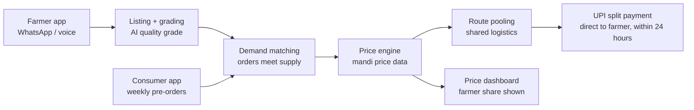

# KisanLink: A Pre-Order, Demand-Pooled Direct Supply Chain from Farm to Consumer

**Smart India Hackathon (SIH-26033)**
**Problem statement:** Multiple intermediaries reduce farmers' earnings and increase consumer prices

**Name:** Sriram
**Reference number:** 26011807

---

## 1. Problem Understanding

In the present system, a farmer harvests first and looks for a buyer afterwards. With no confirmed demand, the farmer sells to whichever trader offers a price. Between the farm and the consumer, produce passes through several intermediaries such as local traders, commission agents and wholesalers, and each one adds a margin.

The result is a loss on both sides. The farmer receives a small share of the final price, and the consumer pays more for the same produce. The root cause is that farmers sell blind, with no demand known in advance, so intermediaries are able to set the price.

## 2. Proposed Solution

KisanLink reverses the order of the chain. Demand is collected first, and supply is committed against it before harvest.

- **Pooled pre-orders:** Consumers in a locality (apartments, colonies and small shops) pool their weekly orders on the platform.
- **Demand visible to farmers:** Farmers see the pooled demand before harvest and commit to supply it at a fair, transparent price.
- **Voice-first farmer access:** Farmers list their expected harvest through WhatsApp or voice in Tamil and other regional languages, so no technical skill is needed.
- **Transparent price band:** A price engine uses mandi (market) price data to suggest a fair price band and shows buyers how the price is split between the farmer, transport and the platform.
- **Pooled logistics:** One collection point per village cluster and one shared delivery route per locality reduce transport cost without middlemen.
- **Quality assurance:** The farmer uploads a photo of the produce and an AI model grades it, so buyers can trust the quality.
- **Direct payment:** UPI split payment settles the amount directly to the farmer within 24 hours.

## 3. Innovation and Uniqueness

Most farmer-to-consumer ideas are listing marketplaces, where farmers post produce and hope for buyers. KisanLink is different in four ways:

- It starts from consumer demand, pooled by locality, instead of from farmer listings.
- It lets farmers commit to supply before harvest, which removes distress selling.
- It makes the price transparent by showing every buyer how much goes to the farmer, transport and platform.
- It is built for farmers who use only a phone and regional language, using WhatsApp and voice.

## 4. Technical Approach

The system works as a pipeline. The farmer lists expected produce through WhatsApp or voice, and the listing and AI grading service records it with a quality grade. Consumer pre-orders arrive from the consumer app. The demand-matching engine connects pooled demand with farmer supply. The price engine, using mandi data, proposes a fair price band. Route-pooling logistics plans shared collection and delivery. UPI split payment then pays the farmer and completes the consumer's transaction, and a price-share dashboard shows how the final price was divided.

### Architecture diagram

Pooled demand sets the price, the route and the payment, in that order.

## 5. Technology Stack

| Layer | Technology |
| --- | --- |
| Farmer interface | WhatsApp Business API with regional-language speech-to-text |
| Consumer app | React or Flutter |
| Backend and database | Django REST framework with PostgreSQL |
| Quality grading | An image classification model on produce photos |
| Routing | A Maps API for pooled collection and delivery routes |
| Payments | UPI split settlement |

## 6. Feasibility

Every component uses existing, widely available technology: WhatsApp, UPI, Maps APIs and standard web frameworks. The solution can be tested as a small pilot with one village cluster of farmers and one locality of consumers before it is extended to more areas. Pooling orders by locality keeps delivery routes short and predictable, which keeps the model practical.

## 7. Impact

- **Farmers:** They know the demand before harvest, receive a fair price, get paid within 24 hours and can see their share of the final price.
- **Consumers:** They benefit from fewer layers in the chain, lower prices, fresher produce and a clear price breakdown.
- **Ecosystem:** Distress selling reduces, logistics are shared and the supply chain becomes transparent.

## 8. Conclusion

KisanLink tackles the problem at its root by giving farmers confirmed demand before harvest. By pooling consumer orders, pricing transparently and paying farmers directly, it removes the need for multiple intermediaries and benefits both farmers and consumers.

